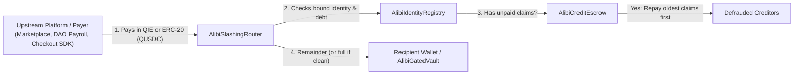

# Alibi Protocol

**Identity-bound credit and B2B payment rails for QIE.** Pay with a small bond instead of 100–150% collateral. If you default, the debt follows your verified identity—not a disposable wallet.

> [!NOTE]
> **Built for QIE Mainnet Hackathon 3.0 — DeFi & Financial Infrastructure**
> **Dual-Environment Production Architecture** *(Agreed with Ved, QIE Team — 29 Oct 2026)*:
> - **QIE Mainnet (Chain `1990`)**: All 5 contracts are deployed, verified, smoke-tested, and hardened (`disableSeeding()`, `lockModules()`). Zero-trust 100%-bond escrow agreements, settlement, default, and garnishment are live on Mainnet today.
> - **QIE Testnet (Chain `1983`) + QIE Pass Staging**: Full identity-bound under-collateralized credit runs live against QIE's official staging partner API (`https://did-stapi.qie.digital`, `pk_test_`), pending `pk_live_` production key issuance for `https://pass-api.qie.digital`.

- **Live Judge Sandbox (Testnet 1983):** [https://alibi-ui.onrender.com/](https://alibi-ui.onrender.com/) *(one-click New → Base → Proven → Default → Garnishment flow)*
- **Demo video:** [YouTube Walkthrough](https://youtu.be/biLtkE_sQmI)
- **Mainnet contracts (Chain 1990):** [Deployed contracts (Mainnet)](#deployed-contracts-mainnet)
- **Testnet contracts (Chain 1983):** [Deployed contracts (QIE testnet)](#deployed-contracts-qie-testnet)

---

## Key Engineering & Security Guarantees

| Category | Proof / Status | Details |
|---|---|---|
| **Automated Test Suite** | **156 tests passing** | **90** Foundry (`forge test`) + **43** Express/TS (`npm test`) + **23** React/Frontend tests |
| **QIE Mainnet Deployment** | **5 / 5 Verified** | Deployed on Chain `1990` at blocks `11485503–11485506` ([`deployments/1990.json`](deployments/1990.json)) |
| **Mainnet Smoke Test** | **Executed on-chain** | Agreement #1 created ([`0x56e3...b03c`](https://mainnet.qie.digital/tx/0x56e36ce3fcbf97151eed0a3ec30fee6023a5f4da8f9a907dbac88e7189acb03c)) & settled ([`0xbb4e...6013`](https://mainnet.qie.digital/tx/0xbb4e83723696e4e86f051dca0b43c9e00f266143f1993d1ceba547a4215b6013)) |
| **Stage 2 Hardening** | **Immutable Locks** | `disableSeeding()` ([`0x8cfd...7364`](https://mainnet.qie.digital/tx/0x8cfd03f14c37d0746e30b707c06d5f436f3a26701e4c5a46f4e3236a29117364)) & `lockModules()` ([`0x771d...eab5`](https://mainnet.qie.digital/tx/0x771dc36db7b02ec7494b96b0d9a8c506cc03798e3fce83a18f6e6ab857d4eab5)) executed |
| **Governance Handoff** | **`Ownable2Step`** | 2-step ownership transfer initiated to `0x29fF...eD55` across Registry, Escrow, Verifier, Vault |
| **Multi-Asset Support** | **Native QIE + ERC-20 (QUSDC)** | `AssetTransferLib` supports `address(0)` (QIE) and any ERC-20 stablecoin (e.g. QUSDC via `VITE_QUSDC_ADDRESS`) |
| **Identity & Privacy** | **Zero-PII EIP-712** | QIE Pass DID hashed on-chain (`hash(DID)`); no KYC personal data touches Alibi |

---

## Dual-Environment Production Architecture

Alibi's smart contracts are production-deployed on QIE Mainnet (`1990`). Because QIE Pass production partner keys (`pk_live_`) are issued separately from staging keys, the live identity-bound credit flow is demonstrated on QIE Testnet (`1983`) with QIE's official staging API—as agreed with the QIE team (Ved, 29 Oct 2026).

| Component | QIE Mainnet (Chain `1990`) | QIE Testnet / Staging (Chain `1983`) |
|---|---|---|
| **Core Contracts** (Registry, Escrow, Router, Vault, Verifier) | **Live & verified** | **Live & verified** |
| **Zero-trust 100%-bond escrow, settlement, default & garnishment** | **Works live today** | **Works live today** |
| **QIE Pass Identity Binding** (`is-verified`, consent, `claim-and-verify`) | Ready; awaits `pk_live_` on `https://pass-api.qie.digital` | **Live** with `pk_test_` on `https://did-stapi.qie.digital` |
| **Judge Sandbox Mode** (`QIE_MODE=mock`, `SANDBOX_ENABLED=true`) | Disabled by design | **Enabled** at [alibi-ui.onrender.com](https://alibi-ui.onrender.com/) |

### Try it in 60 seconds (Judge Sandbox)

Open **[https://alibi-ui.onrender.com/](https://alibi-ui.onrender.com/)** on QIE Testnet (`1983`) to test the full **New → Base → Proven → Default → Garnishment** lifecycle with pre-seeded demo identities—no local setup or `pk_test_` keys required.

<details>
<summary>Or run locally against QIE Testnet (`1983`) with your own QIE Pass partner keys</summary>

Testnet (chain 1983, RPC `https://rpc2testnet.qie.digital/`, explorer https://testnet.qie.digital):

| Contract | Address |
|---|---|
| AlibiIdentityRegistry | `0x3d3a9226801703efD6A8234b33D8a0Ca7193e19d` |
| AlibiCreditEscrow | `0x2776F50c304A6933B5e5Bb9d096F7345E7faB7E4` |
| AlibiSlashingRouter | `0x7bB06a59bDe0a7c5489FBd0617E539fff465A1Eb` |
| AlibiGatedVault | `0x35646BEc61949F0Cb646f3c94fD1283E3969db8a` |
| Eip712AttestationVerifier | `0x80801469d2952670160e4Fabc271912AbaDA8280` |

1. `cd frontend && npm i && node scripts/sync-deployment.mjs 1983`. This writes the testnet addresses into `frontend/.env` and `backend/.env`.
2. In `backend/.env` set:
   ```
   CHAIN_ID=1983
   RPC_URL=https://rpc2testnet.qie.digital/
   QIE_MODE=live
   QIE_BASE_URL=https://did-stapi.qie.digital
   QIE_PUBLIC_KEY=pk_test_...
   QIE_SECRET_KEY=...
   ATTESTOR_PRIVATE_KEY=0x...   # must be an attestor registered on the testnet verifier
   ```
3. `cd backend && npm i && npm run dev` (relayer on `:8787`).
4. `cd frontend && npm run dev`, open http://localhost:5173, connect a QIE Wallet on testnet, and click **Bind this wallet**.
5. No partner keys at all? Set `QIE_MODE=mock` and `SANDBOX_ENABLED=true` to use the Judge sandbox with the demo identities.

</details>

---

## The problem

DeFi cannot tell one person from a thousand wallets. So every loan, escrow and "pay later" deal has to be over-collateralized, usually 150% or more. A buyer who is perfectly trustworthy still has to lock more than the price of what they are buying. That keeps credit out of payments, freelancing, merchant tabs and small business finance.

Reputation on a wallet does not fix this. A wallet is free to create, so a bad actor drops one and opens another.

## What Alibi does

Alibi ties a credit limit to a **verified person**, using **QIE Pass**, instead of to a wallet—and supports both **Native QIE** and **ERC-20 stablecoins (such as QUSDC)** per asset.

1. A person verifies once with QIE Pass.
2. Their wallet is bound to an identity derived from their QIE Pass DID. Nothing is typed in.
3. Their tier sets how much of a deal they must lock up front (the bond). A new person locks all of it. A proven person locks a small share.
4. Deals can be denominated in **Native QIE** or an **ERC-20 token (e.g. QUSDC)**—so merchants, freelancers, and DAOs can price 30-day credit tabs in stablecoins rather than volatile gas tokens.
5. If they miss a deadline, the bond is taken, and the unpaid remainder becomes **debt on the identity**.
6. Any payment later routed through Alibi to **any wallet bound to that identity** repays the debt first.

Starting over costs a new KYC, not a new wallet.

## Architecture & Why Garnishment Works

A common DeFi question is: *"If I default on Alibi, why wouldn't I just tell clients to pay me via a normal transfer instead of `AlibiSlashingRouter`?"*

Alibi is **B2B and platform payment rails** (freelance marketplaces, DAO payroll tools, merchant checkout SDKs), not a voluntary honor system. Payers and platforms route payouts through `AlibiSlashingRouter` because **it gives the payer escrow and dispute protection**. A bad actor cannot receive marketplace payouts, DAO disbursements, or institutional invoices without clearing their identity's debt first.



## Who it is for

| Audience | What they get |
|---|---|
| **Buyers and borrowers** with a QIE Pass | Smaller up-front bonds as they build a record of settled deals in QIE or QUSDC. |
| **Merchants, freelancers and sellers** (creditors) | Payment protection on stablecoin (QUSDC) or QIE credit deals. They set their own minimum tier and minimum bond, so they decide how much risk to take. |
| **QIE apps, marketplaces and DAOs** | A credit, escrow, and garnishment primitive to integrate upstream of payouts—so users get credit without leaving the host app. |

Alibi is infrastructure first. It is not a lending pool and it does not promise large loans.

## What you need to use it

- A QIE Wallet.
- A QIE Pass verification (https://id.qie.digital/verify). Unverified wallets cannot get credit.
- A little QIE for gas (and QUSDC / ERC-20 if settling in a stablecoin).
- The relayer must be reachable to bind an identity. Everything else works without it.

---

## How it works

1. **Connect.** The relayer asks QIE Pass whether the person behind the wallet is verified (`is-verified`). It is a silent yes or no, with no personal data.
2. **Verify if needed.** An unverified wallet sees a gate with a link to QIE Pass and a re-check button.
3. **Bind.** The person approves a consent request in QIE Wallet. The relayer then claims the credential (`claim-and-verify`), accepts it only if QIE reports the signature, expiry and revocation checks as valid, and reads the per-person DID. The wallet signs one challenge, and the relayer signs an EIP-712 attestation that links `wallet -> identityId = hash(DID)`. `registry.linkWallet` verifies it on-chain. Links are permanent.
4. **Add more wallets.** QIE Pass verifies one address (a second account from the same recovery phrase is not verified, tested). So extra wallets join by authorization: the bound wallet authorizes the new address, and the new wallet then adds itself.
5. **Earn a tier.** Settled deals with distinct counterparties, over time, move an identity from New to Base to Proven. Lower tiers pay higher bonds. Staking is optional and raises the limit.
6. **Open an agreement.** Pick Native QIE (`address(0)`) or an ERC-20 token (e.g. QUSDC). The bond is the higher of the tier's bond and the creditor's own minimum.
7. **Settle or default.** Settling on time builds reputation. After the deadline, anyone can call `triggerDefault` and earn a 0.5% keeper bounty. The bond and any stake go to the creditor, and the remainder becomes debt on the identity.
8. **Garnish.** `routePayment` pays a recipient. If the recipient's identity has debt, claims are paid first, oldest first, and the rest is forwarded.

### Tiers

| Tier | How an identity gets there | Effect |
|---|---|---|
| Unverified | No valid QIE Pass binding | No credit. Full bond. |
| New | Verified, little or no history. Any default sends an identity back here. | Highest bond floor. |
| Base | Enough settled deals, enough distinct counterparties, enough age | Lower bond floor, unsecured cap applies |
| Proven | More of the same | Lowest bond floor, higher cap |

The exact thresholds and bond floors are contract configuration (`tierConfig`, `floorBps`). Staking adds to an identity's cap: capacity = tier cap + stake - what is already used. Default caps are 50 QIE (Base) and 200 QIE (Proven) per asset, with a protocol-wide limit of 1,000 QIE of unsecured exposure. ERC-20 assets (such as QUSDC) are supported natively by `AssetTransferLib` and configured per asset via `VITE_QUSDC_ADDRESS` in the frontend.

### Creditor rules

A creditor calls `setCreditorPolicy(minBondBps, minTier)`. From then on, every new agreement with that creditor must lock at least that bond share and come from at least that tier. With no policy set, nothing extra is required. A rule applies to agreements created after it is set.

---

## Why a bad actor cannot simply walk away

- A default drops the identity to the New tier, with a full bond again.
- A fresh start needs a new QIE Pass identity.
- Unsecured credit is capped per identity and protocol-wide.
- Creditors choose their own risk limits.
- Integrated marketplaces and payroll platforms route payouts through `AlibiSlashingRouter` for escrow protection, trapping defaulted identities until claims are cleared.
- The owner can pause new agreements. Settling, defaulting and collecting are never paused.

## Limits, stated plainly

Alibi makes abuse more expensive. It does not make it impossible.

- **Sybil resistance is bounded, not eliminated.** Alibi relies on one KYC profile giving one DID. Two things are not yet confirmed with QIE: that one person gets the same DID from a second wallet, and that QIE stops one person from getting a second DID. If either fails, someone could start a clean identity at the New tier with a full bond.
- **Colluding friends can still bust out.** A group of verified people can build records among themselves, then default on real creditors. They can take up to the caps, once per identity, and each one burns their KYC. Caps, the distinct-counterparty rule, age gating and fees limit this. Do not describe the system as bust-out proof.
- **Garnishment only reaches money sent through the router and the gated vault.** Off-platform direct transfers to unbound wallets are invisible to Alibi; enforcement relies on payers and partner platforms using `AlibiSlashingRouter` for escrow protection.
- **The relayer's attestor key is trusted.** A stolen key could attest any wallet to any identity. It can be rotated with `setAttestor`, and it must be separate from the deployer and keeper keys.
- **No recovery path.** A bound wallet cannot be unlinked.
- **Credit is small by design.**
- **The contracts are unaudited.** Do not use real funds.

## Still to confirm with QIE

- Does a second QIE-verified address of the same person return the same DID?
- Does QIE stop one person from obtaining a second DID?
- Is `claim-and-verify` repeatable per request? (Tested: no. The relayer stores the DID after the first claim.)
- Production `pk_live_` keys for `https://pass-api.qie.digital`, and the official Mainnet QUSDC address and decimals.

---

## Deployed contracts (QIE testnet)

Chain ID 1983. RPC: https://rpc2testnet.qie.digital/. Explorer: https://testnet.qie.digital. The record is `deployments/1983.json`.

| Contract | Address |
|---|---|
| AlibiIdentityRegistry | `0x3d3a9226801703efD6A8234b33D8a0Ca7193e19d` |
| AlibiCreditEscrow | `0x2776F50c304A6933B5e5Bb9d096F7345E7faB7E4` |
| AlibiSlashingRouter | `0x7bB06a59bDe0a7c5489FBd0617E539fff465A1Eb` |
| AlibiGatedVault | `0x35646BEc61949F0Cb646f3c94fD1283E3969db8a` |
| Eip712AttestationVerifier | `0x80801469d2952670160e4Fabc271912AbaDA8280` |

## Repository layout

| Path | What |
|---|---|
| `contracts/` | Solidity 0.8.24 and Foundry: identity registry, escrow, slashing router, EIP-712 verifier, gated vault. 90 tests. |
| `backend/` | TypeScript and Express relayer: QIE Pass client (live or mock), wallet challenge, EIP-712 attestor, identity store, event indexer, optional keeper. 43 tests. |
| `frontend/` | React 18, wagmi v2 and Tailwind. Landing page and app: Identity, Agreements, Pay, Judge sandbox. 23 tests. |
| `deployments/` | Deployment record for QIE testnet. |
| `scripts/` | `export-abis.mjs` exports Foundry ABIs to the backend and frontend. |
| `docs/` | `PRD-v2.1.md` and `MAINNET-CHECKLIST.md`. |

## Run locally (no secrets needed)

```bash
# chain
anvil --port 8546 --chain-id 1983 &

# contracts
cd contracts && forge test

# deploy with demo-sized caps so the 500 QIE scenario works (production defaults are much lower)
BASE_CAP_WEI=200000000000000000000 PROVEN_CAP_WEI=2000000000000000000000 \
GLOBAL_UNSECURED_CAP_WEI=5000000000000000000000 \
DEPLOYER_PRIVATE_KEY=<anvil key> ATTESTOR_ADDRESS=<addr> \
forge script script/Deploy.s.sol --rpc-url http://127.0.0.1:8546 --broadcast

# backend (QIE_MODE=mock). The e2e needs a fresh anvil and deploy each run.
cd ../backend && npm i && npm test && npm run e2e

# frontend
cd ../frontend && npm i && node scripts/sync-deployment.mjs 1983 && npm run dev
```

## Testnet runbook (chain 1983)

Keys live only in untracked `.env` files. Never paste them into chat, issues or commits.

1. Fund a deployer wallet from the QIE testnet faucet. Generate a separate attestor key and a separate keeper key.
2. Deploy: `forge script script/Deploy.s.sol --rpc-url https://rpc2testnet.qie.digital/ --broadcast`. For the demo deal sizes, set the demo caps shown above.
3. `node frontend/scripts/sync-deployment.mjs 1983` fills the address lines in `frontend/.env` and `backend/.env`.
4. In `backend/.env` set `ATTESTOR_PRIVATE_KEY`, `QIE_MODE=live`, `QIE_BASE_URL` and your QIE partner keys. Start with `npm run dev`. A 401 from QIE means a bad or revoked key, or a clock more than 5 minutes off.
5. Real run: connect a QIE-verified wallet and click **Bind this wallet**.
6. Judge sandbox: run a second relayer with `QIE_MODE=mock` and `SANDBOX_ENABLED=true` (it refuses to start unless the chain is 1983). Seed the demo identity with `script/SeedDemo.s.sol`. The sandbox identity's tier is seeded, not earned.

## Mainnet deployment

Deployed and verified on **QIE Blockchain Mainnet** (Chain ID: `1990`). Explorer: [https://mainnet.qie.digital/](https://mainnet.qie.digital/). Primary RPC: `https://rpc1mainnet.qie.digital/`. The official record is [`deployments/1990.json`](deployments/1990.json).

> [!NOTE]
> The contracts are unaudited. Exposure caps are deliberately conservative (50 / 200 / 1,000 QIE). All configuration sources are documented in [`docs/MAINNET-CONFIG-SOURCES.md`](docs/MAINNET-CONFIG-SOURCES.md).

### Deployed contracts (Mainnet)

Every contract source code is verified on the Blockscout explorer:

| Contract | Address | Deploy Tx | Block | Explorer Status |
|---|---|---|---|---|
| **AlibiIdentityRegistry** | [`0xb7aD0880867bD370fFaA5fC3534f44fD2E548Ad8`](https://mainnet.qie.digital/address/0xb7aD0880867bD370fFaA5fC3534f44fD2E548Ad8) | [`0x4dcd...6f82`](https://mainnet.qie.digital/tx/0x4dcd033f51a32a2c4ef78ef692f9a77d717a17ca1e3899470e6591289dfe6f82) | 11485503 | Pass - Verified |
| **AlibiCreditEscrow** | [`0x232eeb51813827738F88F298CbC4215bD4831a82`](https://mainnet.qie.digital/address/0x232eeb51813827738F88F298CbC4215bD4831a82) | [`0x8958...19f4`](https://mainnet.qie.digital/tx/0x89580e38d0e53fe79f0ac29e7717d20179b7d10e1695bce71deaad7a80ac19f4) | 11485504 | Pass - Verified |
| **AlibiSlashingRouter** | [`0x8f5F29b285c286DB5eaC7e66B49188Cc913B2abc`](https://mainnet.qie.digital/address/0x8f5F29b285c286DB5eaC7e66B49188Cc913B2abc) | [`0xdc6c...4a4d`](https://mainnet.qie.digital/tx/0xdc6cbf2402d4489092260fd1602c154115d1a54289a53b792346e2b3ca484a4d) | 11485505 | Pass - Verified |
| **AlibiGatedVault** | [`0xE19E266EfD3492367cF0eeb4D00ca3BAC1ADe549`](https://mainnet.qie.digital/address/0xE19E266EfD3492367cF0eeb4D00ca3BAC1ADe549) | [`0xec63...704a`](https://mainnet.qie.digital/tx/0xec639aa867e85c5b398b80c9316309ee0bc76f8bb6c069b68ee4c24b7292704a) | 11485506 | Pass - Verified |
| **Eip712AttestationVerifier** | [`0xef530aFD52913Dfa62F0Cbc16e34F8b6bB32cD65`](https://mainnet.qie.digital/address/0xef530aFD52913Dfa62F0Cbc16e34F8b6bB32cD65) | [`0x9a0d...e882`](https://mainnet.qie.digital/tx/0x9a0d4a2a166cddbad589430f29a243d4ba629672d794a92c3dc3de7b2c81e882) | 11485503 | Pass - Verified |

### Protocol addresses and caps

- **Deployer**: `0x3dc13a8E85dF58EddaB0653eB2bf018b43118178`
- **Attestor**: `0x38388ECfd6e5235CE20d360Ea26804180bb2EFF7`
- **Keeper**: `0xC0477B7C64fB76C4f5dFc083c9113D59556f5222`
- **New Owner**: `0x29fF710a3244f09d25A64889e2a3C0984B01eD55`
- **Base Tier Cap**: `50 QIE` (`50000000000000000000` wei)
- **Proven Tier Cap**: `200 QIE` (`200000000000000000000` wei)
- **Global Unsecured Cap**: `1,000 QIE` (`1000000000000000000000` wei)
- **Reputation Min Deal**: `1 QIE` (`1000000000000000000` wei)
- **Protocol Fee**: `50 bps` (0.5%)

### Stage 1 on-chain smoke test

- **Create Agreement #1 (0.1 QIE)**: [`0x56e36ce3fcbf97151eed0a3ec30fee6023a5f4da8f9a907dbac88e7189acb03c`](https://mainnet.qie.digital/tx/0x56e36ce3fcbf97151eed0a3ec30fee6023a5f4da8f9a907dbac88e7189acb03c) (Block 11486224)
- **Settle Agreement #1**: [`0xbb4e83723696e4e86f051dca0b43c9e00f266143f1993d1ceba547a4215b6013`](https://mainnet.qie.digital/tx/0xbb4e83723696e4e86f051dca0b43c9e00f266143f1993d1ceba547a4215b6013) (Block 11486229)

### Stage 2 finalization (hardening & governance)

Finalized via `Finalize.s.sol`. All 6 hardening transactions executed on-chain:

| Action | Contract | Transaction Hash |
|---|---|---|
| `disableSeeding()` | `AlibiIdentityRegistry` | [`0x8cfd...7364`](https://mainnet.qie.digital/tx/0x8cfd03f14c37d0746e30b707c06d5f436f3a26701e4c5a46f4e3236a29117364) |
| `lockModules()` | `AlibiIdentityRegistry` | [`0x771d...eab5`](https://mainnet.qie.digital/tx/0x771dc36db7b02ec7494b96b0d9a8c506cc03798e3fce83a18f6e6ab857d4eab5) |
| `transferOwnership(NEW_OWNER)` | `AlibiIdentityRegistry` | [`0x2b6e...e8cf`](https://mainnet.qie.digital/tx/0x2b6e0ca6e85818ebc64fa0a5a9204bc1ab3deb09555cac22fb54314195e7e8cf) |
| `transferOwnership(NEW_OWNER)` | `AlibiCreditEscrow` | [`0x9efd...46fe`](https://mainnet.qie.digital/tx/0x9efd5e48d9f4ecfb20b7f16a2602978b153daee65f0affdec9a76c04be4f46fe) |
| `transferOwnership(NEW_OWNER)` | `Eip712AttestationVerifier` | [`0x03c2...8681`](https://mainnet.qie.digital/tx/0x03c2472454a58d98bf53c8159585838d64d3590bac0b4659c9f8fbd0f1448681) |
| `transferOwnership(NEW_OWNER)` | `AlibiGatedVault` | [`0x143a...345e`](https://mainnet.qie.digital/tx/0x143a35efa48675c34cde3a40dc47389ddc24a10fa5f4e7111edbba231833345e) |

### Verify it yourself

Anyone can verify the mainnet contract state using `cast call`:

```bash
RPC="https://rpc1mainnet.qie.digital/"
REGISTRY="0xb7aD0880867bD370fFaA5fC3534f44fD2E548Ad8"
ESCROW="0x232eeb51813827738F88F298CbC4215bD4831a82"
VERIFIER="0xef530aFD52913Dfa62F0Cbc16e34F8b6bB32cD65"
VAULT="0xE19E266EfD3492367cF0eeb4D00ca3BAC1ADe549"

# 1. Verify linked escrow and router (locked)
cast call --rpc-url $RPC $REGISTRY "escrow()(address)"
# => 0x232eeb51813827738F88F298CbC4215bD4831a82

cast call --rpc-url $RPC $REGISTRY "router()(address)"
# => 0x8f5F29b285c286DB5eaC7e66B49188Cc913B2abc

# 2. Verify conservative exposure caps
cast call --rpc-url $RPC $REGISTRY "unsecuredCap(uint8)(uint256)" 1
# => 50000000000000000000 (50 QIE)

cast call --rpc-url $RPC $REGISTRY "unsecuredCap(uint8)(uint256)" 2
# => 200000000000000000000 (200 QIE)

cast call --rpc-url $RPC $REGISTRY "globalUnsecuredCap()(uint256)"
# => 1000000000000000000000 (1,000 QIE)

# 3. Verify attestor authorization
cast call --rpc-url $RPC $VERIFIER "isAttestor(address)(bool)" 0x38388ECfd6e5235CE20d360Ea26804180bb2EFF7
# => true

# 4. Verify escrow fee and duration
cast call --rpc-url $RPC $ESCROW "feeBps()(uint16)"
# => 50 (0.5%)

cast call --rpc-url $RPC $ESCROW "minDuration()(uint64)"
# => 15 (seconds)

# 5. Verify hardening and ownership transfer
cast call --rpc-url $RPC $REGISTRY "seedingEnabled()(bool)"
# => false (reputation seeding permanently disabled)

cast call --rpc-url $RPC $REGISTRY "modulesLocked()(bool)"
# => true (module configuration permanently frozen)

cast call --rpc-url $RPC $REGISTRY "pendingOwner()(address)"
# => 0x29fF710a3244f09d25A64889e2a3C0984B01eD55
```

## Security notes

- Request signing for QIE Pass is `HMAC-SHA256(publicKey + timestamp, secret)`.
- The KYC Share flow is not used, so Alibi never receives personal data.
- `IDENTITY_ANCHOR=wallet` is a fallback that keys an identity to the verified wallet instead of the DID.
- The relayer stores `wallet -> DID` locally (`QIE_STORE_PATH`). Back it up and keep it out of git.

## License

MIT. See [LICENSE](LICENSE).
